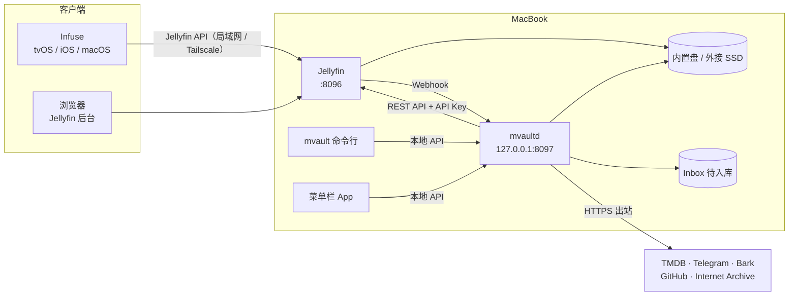
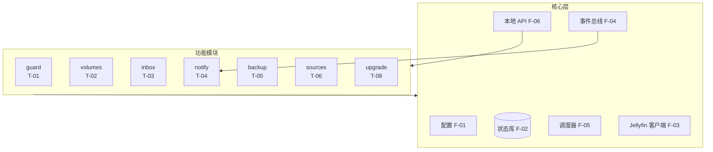
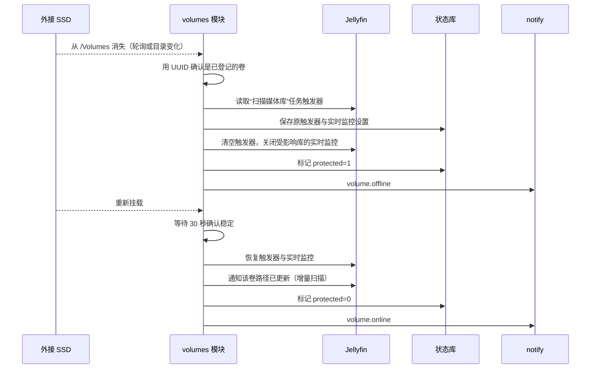
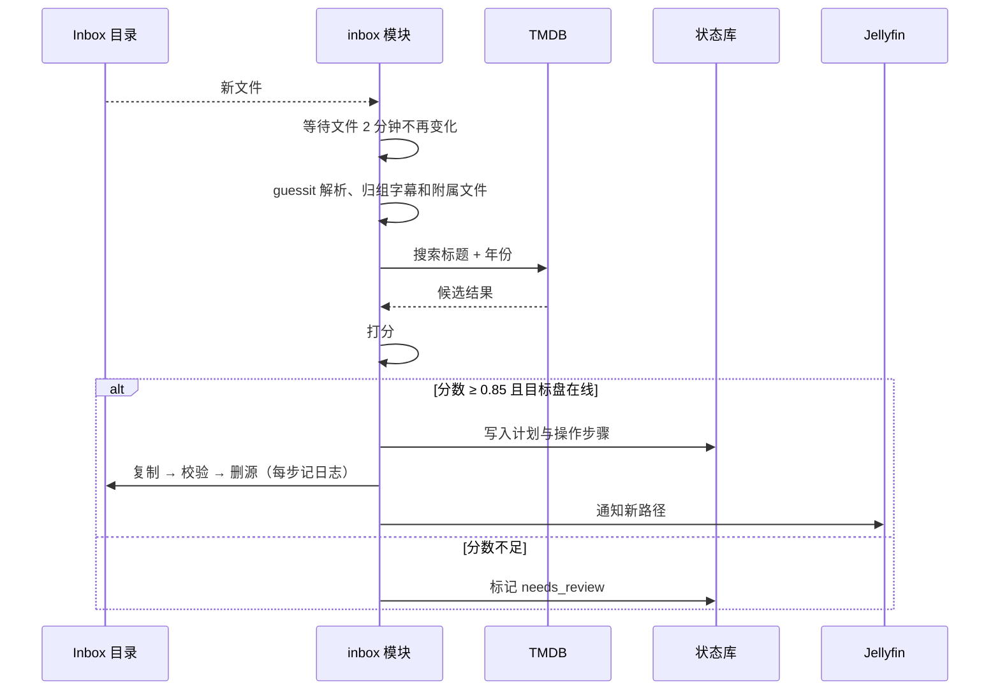
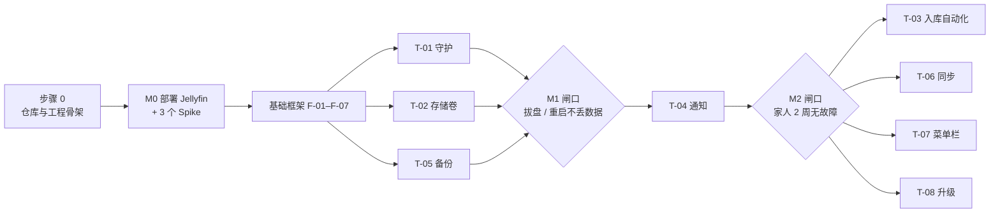

# MediaVault · 需求拆解、架构设计与开发步骤

> 基于 [需求文档](requirements.md)（2026-11-17 版）。本文件回答三件事：每条需求具体做成什么样（第 1 节）、程序怎么组织（第 2 节）、按什么顺序开发和验收（第 3 节）。
>
> 项目代号 **MediaVault**，命令行工具名 `mvault`，常驻进程名 `mvaultd`。

---

## 0. 关键决策一览

| 决策 | 选择 | 理由 |
| --- | --- | --- |
| 媒体服务 | Jellyfin 原生 macOS 版，**不用 Docker** | Docker 在 macOS 上跑在虚拟机里，拿不到 VideoToolbox 硬件加速，读外接盘也多一层 |
| 小工具语言 | Python 3.12+，用 `uv` 管理依赖 | 文件名识别有成熟库 `guessit`，开发快；对家用场景性能足够 |
| 进程形态 | **一个常驻进程 `mvaultd` + 一个命令行 `mvault`** | 8 个工具共用配置、日志、状态库、Jellyfin 客户端和通知；不拆成 8 个进程 |
| 工具自身状态 | SQLite 单文件 | 无需额外服务；与 Jellyfin 的数据库完全分开 |
| 与 Jellyfin 交互 | 只走 REST API + 文件系统 | 不改 Jellyfin 代码、不碰它的数据库，升级互不影响 |
| 菜单栏 App | Swift / SwiftUI `MenuBarExtra` | 只做显示和按钮，逻辑全在 `mvaultd`，通过本地 HTTP 调用 |
| 外接盘监控 | 轮询 `diskutil` + 监听 `/Volumes` 目录变化 | 不引入 pyobjc；10 秒级延迟对家用足够 |
| 开发顺序 | 先做实验（Spike）验证 Jellyfin 的拔盘行为，再定 T-02 的细节 | T-02 的复杂度取决于 Jellyfin 本身是否会删条目 |
| 能用现成的不自研 | 备份 = Jellyfin 内置备份 + restic；通知渠道 = Apprise；整理刮削 = tinyMediaManager | 见需求文档 3.4；自研只做定时、规则和衔接。T-03 入库自动化推迟到 M3 按需做 |

---

## 1. 需求拆解

编号规则：`C-xx` 是 Jellyfin 配置项（做成部署手册 + 自动检查），`T-xx` 是自研工具，`T-xx.n` 是工具下的子需求，`F-xx` 是基础框架能力。每个子需求都有可测的验收标准。

### 1.1 基础框架（所有工具共用）

| 编号 | 子需求 | 说明 | 验收标准 | 阶段 |
| --- | --- | --- | --- | --- |
| F-01 | 配置加载 | 读 `/Library/Application Support/MediaVault/config.yaml`，pydantic 校验；敏感值（API Key、Bot Token）从钥匙串读取 | 配置写错时启动失败并指出字段和原因 | M1 |
| F-02 | 状态库 | SQLite（WAL 模式），带版本化迁移 | 升级工具后自动迁移，迁移前自动备份状态库 | M1 |
| F-03 | Jellyfin 客户端 | 封装认证、重试（指数退避，最多 3 次）、超时（5 秒）和要用到的 API | Jellyfin 停止时调用方得到明确的“服务不可用”错误，而不是卡住 | M1 |
| F-04 | 事件总线 | 进程内发布 / 订阅；每个事件同时写入状态库 `events` 表 | 任一模块发出的事件，通知中心和本地 API 都能收到 | M1 |
| F-05 | 调度器 | 定时任务（备份、健康检查、同步、升级检查），记录每次运行结果 | `mvault jobs` 能列出每个任务的上次运行时间、结果和下次运行时间 | M1 |
| F-06 | 本地 API | 只监听 `127.0.0.1:8097`，给菜单栏 App 和 Jellyfin Webhook 用 | 从其他机器访问 8097 不通 | M1 |
| F-07 | 日志 | JSON 行格式，按天滚动保留 30 天 | `mvault logs --since 1h --module volumes` 可过滤 | M1 |
| F-08 | 自检 `mvault doctor` | 检查 macOS 设置与依赖（见 1.2） | 每项输出“通过 / 警告 / 失败”和修复命令 | M0 |

### 1.2 Jellyfin 配置需求 → 部署手册 + 自动检查

C 类需求不写业务代码，交付物是 `docs/deploy.md` 的操作步骤，加上 `mvault doctor` 里的自动检查。

| 编号 | 操作步骤（写入部署手册） | `doctor` 自动检查 | 阶段 |
| --- | --- | --- | --- |
| C-01 | 建电影 / 剧集 / 家庭视频 3 个库，每库挂内置盘和外接盘文件夹；开实时监控 | 通过 API 读出各库路径，确认与 `config.yaml` 中的卷映射一致 | M0 |
| C-02 | 用 tinyMediaManager 按命名规范整理现有片库并写 NFO；文件夹带 `[tmdbid-xxx]` | `mvault lint <路径>` 列出不合规的文件名（基于 `guessit`，以后 T-03 复用） | M0 |
| C-03 | 语言 zh-CN、国家 SG；装 TheTVDB、OMDb、Fanart 插件 | 检查库的元数据语言和已装插件 | M0 |
| C-04 | 开 NFO 读写、图片存到媒体文件夹 | 检查对应库选项 | M0 |
| C-05 | Infuse 添加服务器；关闭不需要的转码；默认 Library Mode，Jellyfin 装 InfuseSync 插件 | 检查 InfuseSync 插件已装；两种模式的打开速度人工比较 | M0 |
| C-06 | 装 OpenSubtitles 插件，填账号 | 检查插件已装 | M2 |
| C-07 | 为家人建账户、设库权限和儿童分级上限 | 列出用户及权限，标出“能看所有库的非管理员” | M2 |
| C-08 | 开 VideoToolbox 硬件加速 | 检查转码设置 | M2 |
| C-09 | 装 Webhook 插件，地址指向 `http://127.0.0.1:8097/webhook/jellyfin` | 发一条测试事件，看 `mvaultd` 是否收到 | M2 |
| C-10 | 按需装 Intro Skipper、Trakt | 无 | M3 |

`doctor` 还要检查的 macOS 项目（对应需求文档 6.2 / 6.3）：

- 接电时不睡眠（`pmset -g` 中 AC 的 `sleep 0`）、网络唤醒已开、硬盘睡眠已关。
- 所有媒体卷都在 Spotlight 排除列表里（`mdutil -s` 显示 indexing disabled）。
- 防火墙已开；FileVault 按需求文档 6.3 保持关闭（检测到开启时给出提醒：无人值守重启会卡在解锁界面）。
- “查找我的 Mac”已开启。
- Tailscale 已连接，并能拿到本机 Tailscale IP。
- Jellyfin 只监听内网和 Tailscale 地址（检查 `lsof -iTCP:8096 -sTCP:LISTEN`）。
- Jellyfin 和 `mvaultd` 都由 launchd 托管且在运行。

### 1.3 T-01 服务守护（P0）

| 编号 | 子需求 | 实现要点 | 验收标准 |
| --- | --- | --- | --- |
| T-01.1 | Jellyfin 以系统服务运行 | LaunchDaemon `com.mediavault.jellyfin`，用户 `_jellyfin`，`KeepAlive=true`，显式指定数据、缓存、日志目录 | 重启 Mac 后不登录桌面，Infuse 能连上 |
| T-01.2 | 防休眠 | 独立 LaunchDaemon 常驻 `caffeinate -s`（仅接电时阻止系统睡眠） | 接电、合盖（接外接屏）放 8 小时，`pmset -g log` 中无睡眠记录 |
| T-01.3 | 健康检查 | 每 60 秒请求 `GET /health` 和 `GET /System/Info/Public`；记录延迟 | 健康状态和最近 24 小时可用率能在 `mvault status` 看到 |
| T-01.4 | 自动重启 | 连续 3 次失败 → `launchctl kickstart -k`；10 分钟内最多重启 2 次，超过则停止重启并发严重告警 | 用 `kill -STOP` 冻结 Jellyfin 进程，3 分钟内被重启并收到通知 |
| T-01.5 | 电源与温度告警 | 断电（切到电池）、电量 < 30%、电池温度过高时发事件 | 拔掉电源线 1 分钟内收到通知 |

### 1.4 T-02 存储卷监控（P0）

| 编号 | 子需求 | 实现要点 | 验收标准 |
| --- | --- | --- | --- |
| T-02.1 | 卷登记 | `mvault volume add /Volumes/SSD-A`：读卷 UUID，写 `.mediavault-volume` 标识文件，记录它承载的 Jellyfin 库路径 | `mvault volume list` 显示名称、UUID、容量、在线状态、对应库 |
| T-02.2 | 上下线检测 | 监听 `/Volumes` 变化 + 每 10 秒轮询 `diskutil info -plist`；以 UUID 判断是不是同一块盘，挂载点改名也能认出 | 拔盘 15 秒内产生 `volume.offline`；插回且稳定 30 秒后产生 `volume.online` |
| T-02.3 | 离线保护 | 卷离线时：①保存并清空“扫描媒体库”计划任务的触发器；②关闭受影响库的实时监控；③记录到状态库。全部可恢复 | 离线期间 Jellyfin 不发起扫描（看 Jellyfin 日志）；M1 拔盘实验通过 |
| T-02.4 | 上线恢复 | 卷上线：恢复触发器和实时监控 → 对该卷路径触发一次增量扫描 | 插回 2 分钟内条目可播放，进度和已看状态都在 |
| T-02.5 | 进程重启后的状态对齐 | `mvaultd` 启动时比对“实际在线卷”和状态库，补做上一步没做完的保护或恢复 | 离线期间重启 `mvaultd`，触发器仍是清空状态，不会被误恢复 |
| T-02.6 | 空间告警 | 每 10 分钟检查剩余空间：低于 10% 警告，低于 5% 严重 | 用测试磁盘镜像填满到 92%，收到警告 |
| T-02.7 | SMART 告警 | 用 `smartctl` 读健康状态；外接硬盘盒不支持时标记“不可用”，不报错 | 内置盘显示 PASSED；不支持的外接盘显示“不支持 SMART” |
| T-02.8 | 读取故障 | 监控 Jellyfin 日志里的 I/O 错误关键字，出现时告警 | 模拟后能收到告警（Spike 阶段确认可行性） |

> T-02.3 的具体做法依赖 Spike S-1 的结论：若 Jellyfin 在库根目录不可读时本来就不删条目，T-02.3 可简化为只做“暂停扫描”。

### 1.5 T-03 入库自动化（P2，M3 按需）

先用 tinyMediaManager 手动入库，只有手动整理变得费事时才开发本工具。开发前先评估能否用 tinyMediaManager 的命令行模式完成识别和改名，自研只保留监听、跨盘移动、校验和撤销；不行再按下表自己实现。

| 编号 | 子需求 | 实现要点 | 验收标准 |
| --- | --- | --- | --- |
| T-03.1 | 待入库目录监听 | 监听 `Inbox/`；文件大小 2 分钟不变且没有 `.part` / `.crdownload` 等临时后缀才处理 | 正在下载的文件不会被提前搬走 |
| T-03.2 | 文件名识别 | `guessit` 解析标题、年份、季集、分辨率；按同名规则把字幕、NFO、海报归到同一组 | 测试集 200 个真实风格文件名，识别正确率 ≥ 95% |
| T-03.3 | TMDB 匹配 | 用标题 + 年份搜 TMDB，打分：标题相似度、年份差、类型一致；≥ 0.85 自动通过，否则进“待确认” | 低分条目不会自动移动；`mvault inbox review` 可人工选择 |
| T-03.4 | 生成计划 | 按 C-02 规范生成目标路径；按配置选盘（如电影 → SSD-A），目标盘离线或空间不足时换下一候选 | `mvault inbox plan` 以表格展示“源 → 目标”，不改动任何文件 |
| T-03.5 | 执行移动 | 同盘用 rename；跨盘先复制，比对 xxhash 校验和，再删源文件；每一步写日志 | 复制过程中拔盘，源文件仍在、目标残留被清理 |
| T-03.6 | 撤销 | 按日志反向执行：`mvault inbox undo <任务号>` | 撤销后文件回到原位，Jellyfin 中条目消失 |
| T-03.7 | 通知 Jellyfin | 调用“媒体已更新”接口传入新路径；失败则退回到刷新整个库 | 移动完成 60 秒内 Jellyfin 中可见 |
| T-03.8 | 命名检查 | `mvault lint <路径>` 对已有片库给出不合规清单和建议改名 | 能用于 M0 整理现有片库 |

### 1.6 T-04 通知中心（P1）

| 编号 | 子需求 | 实现要点 | 验收标准 |
| --- | --- | --- | --- |
| T-04.1 | 接收 Jellyfin Webhook | `POST /webhook/jellyfin`，校验共享密钥，转换成内部事件 | 新片入库后收到“已入库：片名 (年份)” |
| T-04.2 | 推送渠道 | 用 Apprise 发送，渠道以 Apprise URL 配置（`tgram://`、`bark://`、`mailto://`），可同时启用多个；密钥部分存钥匙串 | `mvault notify test` 三个渠道都收到 |
| T-04.3 | 规则 | 按事件类型和级别路由；相同事件 10 分钟内去重；免打扰时段（默认 23:00–08:00）只发严重级 | 半夜拔盘只收到一条；新片入库推迟到早上汇总 |
| T-04.4 | 汇总 | 每天早上 9 点发一条日报：新入库、播放次数、空间、告警 | 连续 3 天收到日报 |
| T-04.5 | 失败重试 | 推送失败进队列，指数退避重试 24 小时 | 断网 10 分钟后恢复，积压的通知补发 |

### 1.7 T-05 备份（P1）

| 编号 | 子需求 | 实现要点 | 验收标准 |
| --- | --- | --- | --- |
| T-05.1 | Jellyfin 数据备份 | 每天 04:00 调用 Jellyfin 内置备份（10.11 起提供，含数据库、元数据、字幕；接口名开发前在 swagger 核对），在线进行无需停服；内置备份没有定时功能，由本工具触发 | 备份期间 Infuse 正在播放的用户不受影响 |
| T-05.2 | 工具自身备份 | `config.yaml` 和状态库与 Jellyfin 备份包一起存入 restic | 快照里包含三者 |
| T-05.3 | 保留与校验 | restic `forget --keep-daily 14 --keep-weekly 8 --prune`；每周 `restic check --read-data-subset 10%` | `mvault backup list` 显示每个快照的时间、大小和最近校验结果 |
| T-05.4 | 备份去处 | restic 仓库至少一个不与 Jellyfin 数据同盘（第二块盘）；可选第二个仓库放云端（restic 原生支持 S3、B2 等，或经 rclone）；仓库密码存钥匙串 | 内置盘坏了仍能拿到备份 |
| T-05.5 | 家庭录像备份 | 每晚 restic 备份家庭录像目录，有版本历史，误删可找回 | 误删原文件后能从快照找回 |
| T-05.6 | 恢复 | `mvault backup restore <快照>`：restic 取回备份包 → Jellyfin `--restore-archive <zip>` 或后台“备份”页恢复；附恢复演练步骤 | 在测试实例恢复后，用户与观看记录完整（M1 验收项）；同时确认能否恢复到另一台 Mac，不能则补一份停服时的数据目录副本 |

### 1.8 T-06 合法资源同步（P2）

| 编号 | 子需求 | 实现要点 | 验收标准 |
| --- | --- | --- | --- |
| T-06.1 | 来源插件接口 | 每个来源实现“列出条目 / 下载 / 授权信息”三个方法 | 新增来源不改核心代码 |
| T-06.2 | Internet Archive | 用官方 `internetarchive` 库按合集或搜索条件拉取；只接受授权字段为公有领域或 CC 的条目 | 授权不明的条目被跳过并记录原因 |
| T-06.3 | Blender 开放电影 | 内置片单，按分辨率选文件 | 4K 版本下载完整 |
| T-06.4 | 下载控制 | 只在设定时段（默认 01:00–07:00）下载；限速；断点续传；已下载的记一笔不重复下 | 同一条目不会下两次 |
| T-06.5 | 交给入库 | 下载完成后写 NFO（标题、年份、来源、授权），放进 `Inbox/`，由 tinyMediaManager 或 T-03 接手 | 入库后在 Jellyfin 简介里能看到来源和授权 |

### 1.9 T-07 菜单栏 App（P2）

| 编号 | 子需求 | 实现要点 | 验收标准 |
| --- | --- | --- | --- |
| T-07.1 | 状态显示 | 图标颜色表示整体状态（绿 / 黄 / 红）；菜单里列 Jellyfin 状态、各卷在线和空间、正在播放 | 拔盘后 15 秒内图标变黄 |
| T-07.2 | 操作 | 重启 Jellyfin、扫描某个库、打开 Jellyfin 后台、打开日志 | 每个按钮都有成功或失败反馈 |
| T-07.3 | 安全弹出 | 有人正在播放该盘上的片子时先提示；确认后先做离线保护再 `diskutil eject` | 弹出后 Jellyfin 条目不丢 |
| T-07.4 | 开机启动 | 作为登录项启动；连不上 `mvaultd` 时显示“守护进程未运行” | 停掉 `mvaultd` 时菜单显示对应提示 |

### 1.10 T-08 升级守护（P2）

| 编号 | 子需求 | 实现要点 | 验收标准 |
| --- | --- | --- | --- |
| T-08.1 | 版本检查 | 每天查 GitHub 上 Jellyfin 的最新正式版，与本机版本比较 | 有新版本时收到通知，带发布说明和 Infuse 论坛链接 |
| T-08.2 | 升级前检查 | 无人播放；最近一次备份在 24 小时内且校验通过；磁盘空间足够 | 任一条件不满足则拒绝升级并说明原因 |
| T-08.3 | 执行升级 | 立即备份 → 停服务 → 保留旧版程序 → 安装新版 → 启动 | 整个过程一条命令完成，有进度输出 |
| T-08.4 | 冒烟测试 | 健康检查、列出媒体库、取一个条目的播放信息 | 任一失败即进入回滚 |
| T-08.5 | 回滚 | 恢复旧版程序和升级前的数据备份 | 人为让冒烟测试失败，能回到旧版且数据完整 |

### 1.11 非功能需求的落实

| 需求文档条目 | 落实方式 |
| --- | --- |
| 6.1 性能（列表响应、起播时间） | 由 Jellyfin 本身决定；M0 用脚本对 `/Items` 和起播做一次基准测试并记录 |
| 6.1 空闲资源 | `mvaultd` 自身目标：空闲 CPU < 0.5%、内存 < 80 MB |
| 6.2 开机自启、防休眠 | T-01.1、T-01.2 |
| 6.2 外接盘按 UUID 识别 | T-02.1、T-02.2 |
| 6.2 数据备份 | T-05 |
| 6.3 不开端口、只监听内网 | 部署手册 + `doctor` 检查 |
| 6.3 API Key 存钥匙串 | F-01 |
| 6.3 低权限运行 | 见 2.6 |
| 6.4 部署可重建 | `docs/deploy.md` + `deploy/` 下的 plist 与脚本 + `doctor` |

---

## 2. 架构设计

### 2.1 系统上下文



原则：

- Infuse 只和 Jellyfin 打交道，MediaVault 挂了也不影响看片。
- `mvaultd` 是唯一会修改 Jellyfin 设置和移动媒体文件的组件；命令行和菜单栏 App 都通过它操作，不直接调用 Jellyfin。
- 唯一的例外是 `mvault doctor` 和 `mvault backup restore`，它们在 `mvaultd` 没运行时也要能用，所以可以直接执行。

### 2.2 进程与 launchd 任务

| launchd 标签 | 类型 | 运行用户 | 程序 | 说明 |
| --- | --- | --- | --- | --- |
| `com.mediavault.jellyfin` | LaunchDaemon | `_jellyfin` | Jellyfin 服务端可执行文件 + `--datadir` 等参数 | `KeepAlive=true`；开机即运行，无需登录 |
| `com.mediavault.caffeinate` | LaunchDaemon | root | `/usr/bin/caffeinate -s` | 接电时阻止系统睡眠 |
| `com.mediavault.daemon` | LaunchDaemon | `_mvault` | `mvaultd` | 所有工具逻辑 |
| `com.mediavault.menubar` | 登录项 | 本人 | `MediaVault.app` | 仅在登录后显示 |

需要提升权限的操作只有三个，通过 `/etc/sudoers.d/mediavault` 精确放行给 `_mvault`，不给 root：

```
_mvault ALL=(root) NOPASSWD: /bin/launchctl kickstart -k system/com.mediavault.jellyfin
_mvault ALL=(root) NOPASSWD: /bin/launchctl bootout system/com.mediavault.jellyfin
_mvault ALL=(root) NOPASSWD: /bin/launchctl bootstrap system /Library/LaunchDaemons/com.mediavault.jellyfin.plist
```

`diskutil eject` 和读取卷信息不需要 root。升级时替换 Jellyfin 程序文件，则让 `_mvault` 对 Jellyfin 程序目录有写权限即可。

> Jellyfin macOS 安装包里服务端可执行文件的确切路径和启动参数，在 Spike S-3 中确认后写进 plist。

### 2.3 `mvaultd` 内部结构



- 每个模块是一个类，实现 `start()` / `stop()`，在启动时向调度器注册定时任务、向事件总线订阅事件。
- 模块之间**只通过事件通信**，不直接调用彼此。例如 T-02 发出 `volume.offline`，T-03 收到后暂停往该盘移动文件，T-04 收到后发通知。
- 用 `asyncio` 单进程运行；耗时的文件复制和打包放到线程池，避免阻塞健康检查。
- 模块可以在配置里单独关闭（如 `sources.enabled: false`）。

### 2.4 事件清单

| 事件 | 发出方 | 级别 | 主要订阅方 |
| --- | --- | --- | --- |
| `jellyfin.down` / `jellyfin.up` / `jellyfin.restarted` | guard | 严重 / 信息 / 警告 | notify、菜单栏 |
| `jellyfin.restart_giveup` | guard | 严重 | notify |
| `power.on_battery` / `power.low` | guard | 警告 / 严重 | notify |
| `volume.offline` / `volume.online` | volumes | 警告 / 信息 | inbox、notify、菜单栏 |
| `volume.space_low` / `volume.smart_fail` | volumes | 警告 / 严重 | notify |
| `inbox.planned` / `inbox.needs_review` / `inbox.imported` / `inbox.failed` | inbox | 信息 / 警告 / 信息 / 警告 | notify |
| `media.added` / `playback.started` | 来自 Jellyfin Webhook | 信息 | notify（汇总进日报） |
| `backup.ok` / `backup.failed` | backup | 信息 / 严重 | notify |
| `upgrade.available` / `upgrade.done` / `upgrade.rolled_back` | upgrade | 信息 / 信息 / 严重 | notify |

### 2.5 状态库表结构

```sql
-- 已登记的存储卷
CREATE TABLE volumes (
  uuid TEXT PRIMARY KEY,
  name TEXT NOT NULL,
  mount_point TEXT,               -- 最近一次挂载点
  online INTEGER NOT NULL,
  last_seen_at TEXT,
  protected INTEGER NOT NULL DEFAULT 0   -- 离线保护是否生效中
);

-- 卷与 Jellyfin 库路径的对应关系
CREATE TABLE volume_libraries (
  volume_uuid TEXT REFERENCES volumes(uuid),
  library_id TEXT NOT NULL,
  path TEXT NOT NULL,
  PRIMARY KEY (volume_uuid, library_id, path)
);

-- 离线保护时保存的原始设置，用于恢复
CREATE TABLE saved_settings (
  key TEXT PRIMARY KEY,           -- 如 task_triggers:<taskId>、realtime:<libraryId>
  value_json TEXT NOT NULL,
  saved_at TEXT NOT NULL
);

-- 入库任务与每一步操作（用于撤销）
CREATE TABLE inbox_jobs (
  id INTEGER PRIMARY KEY,
  source_path TEXT NOT NULL,
  status TEXT NOT NULL,           -- pending / needs_review / planned / applying / done / failed / undone
  tmdb_id INTEGER,
  confidence REAL,
  plan_json TEXT,
  created_at TEXT NOT NULL,
  updated_at TEXT NOT NULL
);
CREATE TABLE inbox_ops (
  id INTEGER PRIMARY KEY,
  job_id INTEGER REFERENCES inbox_jobs(id),
  seq INTEGER NOT NULL,
  op TEXT NOT NULL,               -- mkdir / copy / verify / delete / rename
  src TEXT, dst TEXT,
  checksum TEXT,
  done_at TEXT
);

CREATE TABLE events (
  id INTEGER PRIMARY KEY,
  type TEXT NOT NULL,
  level TEXT NOT NULL,
  payload_json TEXT NOT NULL,
  created_at TEXT NOT NULL
);

CREATE TABLE job_runs (           -- 调度任务运行记录
  id INTEGER PRIMARY KEY,
  job TEXT NOT NULL,
  started_at TEXT NOT NULL,
  finished_at TEXT,
  ok INTEGER,
  message TEXT
);

CREATE TABLE notifications (      -- 待发与已发通知（失败重试用）
  id INTEGER PRIMARY KEY,
  event_id INTEGER REFERENCES events(id),
  channel TEXT NOT NULL,
  status TEXT NOT NULL,           -- queued / sent / failed
  attempts INTEGER NOT NULL DEFAULT 0,
  next_try_at TEXT
);

CREATE TABLE backups (
  id INTEGER PRIMARY KEY,
  jellyfin_archive TEXT,          -- Jellyfin 内置备份生成的 zip 文件名
  repo TEXT NOT NULL,             -- restic 仓库
  snapshot_id TEXT NOT NULL,      -- restic 快照 ID
  kind TEXT NOT NULL,             -- daily / pre_upgrade / home_videos
  size_bytes INTEGER,
  checked_at TEXT,                -- 最近一次 restic check 通过的时间
  created_at TEXT NOT NULL
);

CREATE TABLE source_items (       -- T-06 已下载条目，避免重复
  source TEXT NOT NULL,
  item_id TEXT NOT NULL,
  license TEXT,
  status TEXT NOT NULL,
  downloaded_at TEXT,
  PRIMARY KEY (source, item_id)
);
```

### 2.6 文件与目录布局

| 路径 | 内容 | 所有者 |
| --- | --- | --- |
| `/Applications/Jellyfin.app` | Jellyfin 程序 | `_mvault`（升级时可替换） |
| `/Library/Application Support/Jellyfin/{config,data}` | Jellyfin 配置与数据库 | `_jellyfin` |
| `/Library/Caches/Jellyfin` | Jellyfin 图片缓存、转码临时文件 | `_jellyfin` |
| `/Library/Logs/Jellyfin` | Jellyfin 日志 | `_jellyfin`，`_mvault` 可读 |
| `/Library/Application Support/MediaVault/config.yaml` | 工具配置 | `_mvault` |
| `/Library/Application Support/MediaVault/state.db` | 工具状态库 | `_mvault` |
| `/Library/Logs/MediaVault/` | 工具日志 | `_mvault` |
| `/Volumes/<盘>/Movies`、`/TV Shows`、`/Home Videos` | 媒体文件 | `_mvault` 读写，`_jellyfin` 只读 |
| `<内置盘或指定盘>/Inbox/` | 待入库目录 | 本人与 `_mvault` 读写 |
| `<备份盘>/MediaVaultBackups/` | 备份 | `_mvault` |

权限做法：媒体目录属组设为 `mediavault`，`_mvault` 和本人加入该组并有写权限；`_jellyfin` 只通过“其他人可读”获得读权限，从而做到需求文档 6.3 的“Jellyfin 对媒体目录只读”。

### 2.7 配置文件示例

```yaml
jellyfin:
  url: http://127.0.0.1:8096
  api_key: keychain:mediavault/jellyfin   # 从钥匙串读取
  launchd_label: com.mediavault.jellyfin

volumes:
  - name: SSD-A
    uuid: 1A2B3C4D-0000-0000-0000-000000000001
    libraries: [Movies]
  - name: SSD-B
    uuid: 1A2B3C4D-0000-0000-0000-000000000002
    libraries: [TV Shows]
  space_warn_pct: 10
  space_critical_pct: 5

inbox:
  path: /Users/Shared/Inbox
  auto_apply_confidence: 0.85
  stable_seconds: 120
  targets:                      # 按类型选盘，依次尝试
    movie: [SSD-A, Internal]
    episode: [SSD-B, Internal]
  tmdb_api_key: keychain:mediavault/tmdb

notify:
  quiet_hours: "23:00-08:00"
  daily_digest: "09:00"
  channels:                     # Apprise URL，整条存钥匙串
    - keychain:mediavault/apprise-telegram   # tgram://<bot_token>/<chat_id>
    - keychain:mediavault/apprise-bark       # bark://<host>/<device_key>
    # - keychain:mediavault/apprise-email    # mailto://...

backup:
  schedule: "04:00"
  repos:                        # restic 仓库，密码存钥匙串
    - path: "/Volumes/SSD-B/MediaVaultBackups"
      password: keychain:mediavault/restic
  keep_daily: 14
  keep_weekly: 8
  home_videos: ["/Volumes/SSD-A/Home Videos"]

sources:
  enabled: false
  window: "01:00-07:00"
  rate_limit_mbps: 50
  internet_archive:
    collections: [feature_films]
    allowed_licenses: [publicdomain, cc-by, cc-by-sa]

upgrade:
  check_daily: true
  auto_apply: false
```

### 2.8 本地 API（`127.0.0.1:8097`）

| 方法与路径 | 用途 | 调用方 |
| --- | --- | --- |
| `GET /status` | 汇总状态：Jellyfin、各卷、正在播放、最近告警 | 菜单栏、`mvault status` |
| `GET /events?since=` | 事件流 | 菜单栏、`mvault logs` |
| `POST /jellyfin/restart` | 重启 Jellyfin | 菜单栏、命令行 |
| `POST /libraries/{id}/scan` | 扫描某个库 | 菜单栏、命令行 |
| `POST /volumes/{uuid}/eject` | 安全弹出（先离线保护） | 菜单栏 |
| `GET /inbox`、`POST /inbox/{job}/apply`、`POST /inbox/{job}/undo` | 入库任务查看与操作 | 命令行 |
| `POST /backup/run` | 立即备份 | 命令行 |
| `POST /webhook/jellyfin` | 接收 Jellyfin Webhook（校验共享密钥） | Jellyfin |

本地 API 用一个随机令牌鉴权，令牌存在仅 `mediavault` 组可读的文件里，防止本机其他程序随意调用。

### 2.9 用到的 Jellyfin API

以下接口按 Jellyfin 公开 API 整理，**开发前用本机 `http://127.0.0.1:8096/api-docs/swagger` 逐一核对**，以实际版本为准：

| 用途 | 接口 | 用于 |
| --- | --- | --- |
| 健康检查 | `GET /health`、`GET /System/Info/Public` | T-01、T-08 |
| 正在播放 | `GET /Sessions` | T-05、T-07、T-08 |
| 计划任务 | `GET /ScheduledTasks`、`POST /ScheduledTasks/{id}/Triggers` | T-02 |
| 媒体库与选项 | `GET /Library/VirtualFolders`、`POST /Library/VirtualFolders/LibraryOptions` | T-02、doctor |
| 刷新 | `POST /Library/Media/Updated`、`POST /Library/Refresh` | T-02、T-03 |
| 冒烟测试 | `GET /Users/{id}/Views`、`POST /Items/{id}/PlaybackInfo` | T-08 |
| 备份 | 10.11 起的内置备份接口（创建、列出备份） | T-05、T-08 |

认证使用 `Authorization: MediaBrowser Token="<API Key>", Client="MediaVault", Version="x.y.z"` 请求头。

### 2.10 关键流程

**外接盘离线与恢复（T-02）**



**入库整理（T-03）**



**升级（T-08）**：检查条件 → 备份（kind=pre_upgrade）→ 停止 Jellyfin → 把旧版程序移到 `Jellyfin.app.prev` → 安装新版 → 启动 → 冒烟测试 → 通过则保留旧版 7 天后删除；失败则停止 → 恢复旧版程序，用 `--restore-archive` 恢复升级前的备份 → 启动 → 发严重告警。

### 2.11 技术栈与依赖

| 用途 | 选择 |
| --- | --- |
| 运行时 | Python 3.12+，`uv` 管理虚拟环境与锁定依赖 |
| 命令行 | `typer` |
| HTTP 客户端 / 服务端 | `httpx`（异步）/ `starlette` + `uvicorn` |
| 配置校验 | `pydantic` |
| 定时任务 | `APScheduler` 3.x |
| 目录监听 | `watchdog`（macOS 下基于 FSEvents） |
| 文件名解析 | `guessit`（`mvault lint`；T-03 若开发也用它） |
| 通知发送 | `apprise` |
| 校验和 | `xxhash`（T-03 跨盘移动校验） |
| 钥匙串 | `keyring` |
| Internet Archive | `internetarchive` |
| 系统命令 | `diskutil`、`pmset`、`smartctl`（Homebrew `smartmontools`）、`restic`（Homebrew） |
| 片库整理（人工） | tinyMediaManager |
| 测试 | `pytest`、`pytest-asyncio`、`respx`（模拟 HTTP） |
| 代码质量 | `ruff`（格式与检查）、`mypy` |
| 菜单栏 App | Swift 5.9+ / SwiftUI，macOS 13+ |

### 2.12 代码仓库结构

```
emby/
├── README.md
├── docs/
│   ├── requirements.md         需求文档
│   ├── design.md               本文件
│   └── deploy.md               部署手册（M0 产出）
├── pyproject.toml
├── src/mediavault/
│   ├── cli.py                  mvault 命令入口
│   ├── daemon.py               mvaultd 入口，装配核心与模块
│   ├── core/
│   │   ├── config.py
│   │   ├── state.py            状态库与迁移
│   │   ├── events.py
│   │   ├── scheduler.py
│   │   ├── jellyfin.py         Jellyfin 客户端
│   │   ├── api.py              本地 API
│   │   └── macos.py            diskutil / pmset / launchctl 封装
│   ├── modules/
│   │   ├── guard.py            T-01
│   │   ├── volumes.py          T-02
│   │   ├── inbox/              T-03（parse.py, match.py, plan.py, apply.py）
│   │   ├── notify/             T-04（rules.py, digest.py, send.py 封装 Apprise）
│   │   ├── backup.py           T-05（调用 Jellyfin 备份接口与 restic）
│   │   ├── sources/            T-06（base.py, internet_archive.py, blender.py）
│   │   └── upgrade.py          T-08
│   ├── doctor.py               F-08
│   └── migrations/             状态库迁移脚本
├── menubar/                    T-07（Xcode 工程）
├── deploy/
│   ├── launchd/                三个 LaunchDaemon plist
│   ├── sudoers.d/mediavault
│   ├── install.sh              建用户、建目录、设权限、装 plist
│   └── config.example.yaml
└── tests/
    ├── unit/
    ├── integration/            对真实 Jellyfin 的测试
    └── fixtures/filenames.txt  文件名识别测试集
```

### 2.13 测试策略

| 层级 | 做法 | 覆盖 |
| --- | --- | --- |
| 单元测试 | 纯函数为主：文件名解析、打分、计划生成、通知规则、备份保留策略；系统命令用假实现替换 | 每次提交运行 |
| 集成测试 | 在 Mac 上起一个测试用 Jellyfin（独立端口与数据目录），用 Blender 开放电影做片源 | 与 Jellyfin 交互的模块 |
| 外接盘模拟 | 用 `hdiutil create` 建 APFS 磁盘镜像，`hdiutil attach / detach` 模拟插拔，有真实 UUID | T-02、T-03 跨盘移动、T-07 弹出 |
| 故障注入 | `kill -STOP` 冻结 Jellyfin、复制中途 `detach` 磁盘镜像、断网 | T-01、T-03、T-04 |
| 人工验收 | 需求文档第 8 节的 M0 / M1 验收清单，用真实 Apple TV + Infuse | 每个阶段闸口 |

---

## 3. 开发步骤

时间按业余时间估算（每周约 8–10 小时）：步骤 0–1 对应 M0（第 1–2 周），步骤 2–3 对应 M1（第 3–5 周），步骤 4 对应 M2（第 6–7 周），步骤 5 对应 M3（第 8 周起）。每一步都有“完成标准”，没达到不进入下一步。



### 步骤 0 · 工程骨架（0.5 周）

- [ ] 用 `uv init` 建 Python 项目，配好 `ruff`、`mypy`、`pytest`，加 `pre-commit`
- [ ] 建 2.12 的目录结构，`mvault --version` 能运行
- [ ] 写 `deploy/config.example.yaml` 和 pydantic 配置模型（F-01 的雏形）
- [ ] 准备测试素材：下载 2–3 部 Blender 开放电影（含 4K），整理 200 条文件名测试集

完成标准：`uv run pytest` 通过；`mvault --help` 列出预留的子命令。

### 步骤 1 · M0 部署 Jellyfin 与实验（1–1.5 周）

1. **部署**（对应 C-01 至 C-05）
   - [ ] 安装 Jellyfin，先按普通 App 方式跑通
   - [ ] 装 tinyMediaManager，按 C-02 整理现有片库并写 NFO；写 `mvault lint`（基于 `guessit`）检查结果
   - [ ] 建库、设语言、装插件、开 NFO
   - [ ] Jellyfin 装 InfuseSync 插件；Infuse 添加服务器，分别用 Library Mode 和 Direct Mode 试用并定下默认；装 Tailscale
   - [ ] 把每一步写进 `docs/deploy.md`
2. **Spike S-1：Jellyfin 的拔盘行为**
   - [ ] 拔掉外接盘 → 手动运行一次库扫描 → 插回，记录条目、进度、已看状态是否保留
   - [ ] 分别测试“开 / 关实时监控”两种情况
   - [ ] 结论写进本文件 1.4 的备注，决定 T-02.3 的最终做法
3. **Spike S-2：Infuse 与当前 Jellyfin 版本的兼容性**
   - [ ] 跑 M0 验收清单，尤其是“多季剧集打开 < 3 秒”
   - [ ] 记录 Jellyfin 与 Infuse 版本号，作为日后升级的基线
4. **Spike S-3：以 LaunchDaemon 运行 Jellyfin**
   - [ ] 找到安装包中的服务端可执行文件与启动参数
   - [ ] 用 `_jellyfin` 用户手动跑通，确认 VideoToolbox 在非登录会话下可用
5. **`mvault doctor` 第一版**（F-08）：实现 1.2 中的 macOS 检查项

完成标准：需求文档 M0 验收清单全部勾选；三个 Spike 都有书面结论。若 S-1 或 S-2 结论很差（如拔盘必丢资料、Infuse 严重不兼容），暂停并重新评估是否启动需求文档第 5 节的自研方案。

### 步骤 2 · 基础框架（1 周）

- [ ] F-01 配置加载（含钥匙串读取）
- [ ] F-02 状态库与迁移机制，建 2.5 的表
- [ ] F-03 Jellyfin 客户端：先实现 2.9 中的接口，并对测试 Jellyfin 写集成测试
- [ ] F-04 事件总线、F-05 调度器、F-07 日志
- [ ] F-06 本地 API 骨架，`GET /status` 返回空状态
- [ ] `mvaultd` 能以前台方式启动、`Ctrl+C` 正常退出
- [ ] `deploy/install.sh`：建 `_mvault`、`_jellyfin` 用户和 `mediavault` 组，建目录、设权限，安装 plist 和 sudoers

完成标准：`install.sh` 在一台干净的 macOS 用户环境里可重复执行；`mvaultd` 作为 LaunchDaemon 运行 24 小时无错误日志。

### 步骤 3 · M1 稳定性工具（1.5–2 周）

按 T-01 → T-02 → T-05 的顺序开发，每个工具先写单元测试，再接真实环境。

- [ ] **T-01**：把 Jellyfin 切换到 LaunchDaemon 运行；`caffeinate` 任务；健康检查与限次重启；电源事件
- [ ] **T-02**：卷登记命令、上下线检测、离线保护与恢复、启动对齐、空间与 SMART 告警
  - 用磁盘镜像写自动化测试：挂载 → 登记 → 卸载 → 检查触发器已清空 → 挂载 → 检查已恢复
- [ ] **T-05**：定时调用 Jellyfin 内置备份、restic 入库与保留、每周校验、家庭录像备份、恢复命令
- [ ] 通知暂时只写日志（T-04 在下一步做），但事件要发全
- [ ] 跑需求文档 M1 验收清单，并做一次完整恢复演练

完成标准：M1 验收清单全部通过；连续 7 天无人工干预运行。

### 步骤 4 · M2 效率工具（约 2 周）

- [ ] **T-04 通知中心**：用 Apprise 接 Telegram、Bark、邮件；规则、免打扰、去重、日报、失败重试；接 Jellyfin Webhook（C-09）
- [ ] 配置 C-06 至 C-08：字幕插件、家人账户与儿童分级、硬件加速
- [ ] 新片继续用 tinyMediaManager 手动入库，记录每部花多少时间，作为是否开发 T-03 的依据
- [ ] 让家人正常使用 2 周，记录问题

完成标准：家人连续 2 周使用无故障；通知按规则送达，免打扰和日报正常。

### 步骤 5 · M3 增强（按需，每项约 1 周）

建议顺序：

1. **T-08 升级守护**：Jellyfin 迟早要升级，这个最有价值。先做检查与通知，再做一键升级和回滚；用测试 Jellyfin 演练一次回滚
2. **T-07 菜单栏 App**：先只读显示状态，再加操作按钮，最后做安全弹出
3. **T-03 入库自动化**（手动整理变得费事时才做）：先评估 tinyMediaManager 命令行；自研则依次做解析与归组（200 条测试集 ≥ 95%）、TMDB 匹配与 `review`、`plan` 预览、复制 → 校验 → 删源与撤销、目录监听与自动执行。完成标准：至少处理 20 部新片，无错移、无丢文件
4. **T-06 合法资源同步**：先接 Blender（简单），再接 Internet Archive；入库可先交给 tinyMediaManager
5. C-10：按需装片头跳过和 Trakt 插件

每项完成标准见 1.5、1.8 至 1.10 的验收列。

### 3.1 风险与对策

| 风险 | 影响 | 对策 |
| --- | --- | --- |
| S-1 发现 Jellyfin 拔盘必丢资料，且关扫描也挡不住 | T-02 无法保护数据 | 改为“盘离线时整体停止 Jellyfin”，或启动自研方案 |
| Jellyfin API 在新版本中变化 | 工具失效 | Jellyfin 客户端集中在一个文件；集成测试覆盖所有用到的接口；升级前先在测试实例跑 |
| `_jellyfin` 用户在非登录会话中用不了 VideoToolbox | 远程兜底转码不可用 | 只影响 C-08；可退回到在本人账户下以 LaunchAgent 运行 Jellyfin，并开启自动登录（未开 FileVault，此方案可用） |
| 外接盘盒不支持 SMART | 无法预警硬盘故障 | 接受“不可用”；靠备份和镜像兜底；换支持 SAT 的硬盘盒 |
| 入库识别错误把文件放错位置 | 片库混乱 | 低分进人工确认；所有移动可撤销；先在测试目录跑一周再开自动执行 |
| Jellyfin 内置备份不能恢复到另一台 Mac，或接口变化 | 换机或升级回滚受阻 | M1 演练时确认；不行则每周另做一份停服时的数据目录副本存入 restic |

### 3.2 每步交付物汇总

| 步骤 | 代码 | 文档 | 验证 |
| --- | --- | --- | --- |
| 0 | 工程骨架、配置模型 | — | 单元测试通过 |
| 1 | `mvault lint`、`mvault doctor` | `deploy.md`、Spike 结论 | M0 验收清单 |
| 2 | 核心层、`install.sh`、plist | 更新 `deploy.md` | 24 小时稳定运行 |
| 3 | T-01、T-02、T-05 | 恢复演练记录 | M1 验收清单、7 天无干预 |
| 4 | T-04 | tinyMediaManager 入库说明 | 家人 2 周无故障 |
| 5 | T-03、T-06、T-07、T-08 | 升级与回滚手册 | 各工具验收列 |
