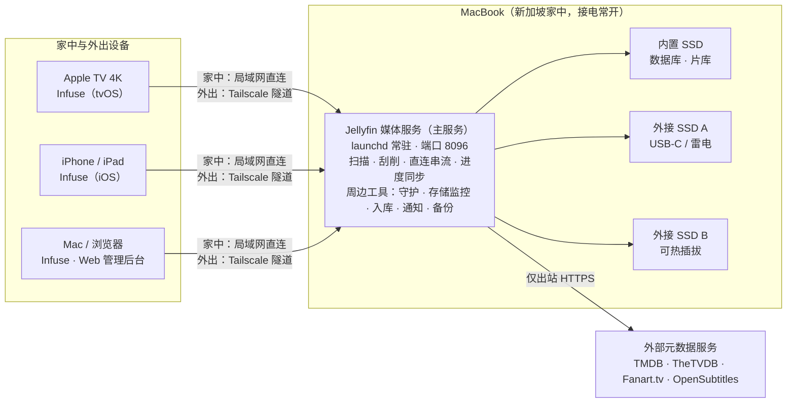

# 本地 Emby 影视仓库 · 功能设计与需求文档

> 更新日期：2026-11-17 · 在线协作版：https://claude.ai/artifact/S6hTbQdtEeGoWTorqTNids

## 1. 产品概述

结论：以 **Jellyfin 作为长期主服务**，运行在 macOS 上，再自研几个周边小工具，补齐笔记本当服务器和外接盘场景下的短板。Infuse 自带强大的本地解码，几乎所有格式都能直接播放，服务端不需要重型实时转码。

**定位**：居家自用的私人影视仓库，存放在 MacBook 内置盘或外接 SSD，家里的 Apple TV / iPhone / iPad / Mac 通过 Infuse 直接连接，外出时可安全远程访问。

**目标用户**：家庭成员 1–5 人，含可能的儿童账户；管理员即本人。

**核心目标**

1. Infuse、Emby 官方客户端、Jellyfin 系客户端（如 Swiftfin）可以直接登录、浏览、播放。
2. 电影、剧集、纪录片、家庭录像自动识别、刮削海报与简介，资料库体验接近 Netflix。
3. 多块存储（内置盘 + 一或多块外接 SSD）统一成一个媒体库；硬盘拔掉时资料不丢、插回自动恢复。
4. 观看进度、已看/未看、收藏在所有设备间同步。
5. 在笔记本上 7×24 稳定运行，低功耗、低维护。

**范围之外（v1 不做）**

- 面向公众或多租户的分享、付费会员体系。
- 直播电视 / DVR、音乐和有声书库（v2 再评估）。
- 自研媒体服务端（降为备选，见第 5 节）；与任何盗版资源站对接；资源来源见第 7 节的合法渠道。
- 4K HDR 实时转码（Infuse 直连即可，转码只做低码率远程兜底）。

## 2. 部署架构

所有片源和数据库都在新加坡家中的 MacBook 上，客户端只连服务端的 8096 端口；外出时经 Tailscale 回家，路由器上不开任何端口。



存储卷按 UUID 识别，盘离线时资料与进度保留。

服务端是唯一读盘的进程：Infuse 不直接访问 SSD，而是通过 Jellyfin API 拿到片单与串流地址，所以外接盘换口、换名都不影响客户端。

### 2.1 远程访问方案

| 方案 | 做法 | 适合 | 注意 |
| --- | --- | --- | --- |
| [Tailscale](https://tailscale.com)（推荐） | Mac 与各设备装 Tailscale，Infuse 填 `100.x.x.x:8096` 或 MagicDNS 名 | 家人自用，零配置、端到端加密 | Apple TV 需装 tvOS 版 Tailscale |
| [Cloudflare Tunnel](https://www.cloudflare.com/products/tunnel/) | `cloudflared` 把服务暴露为 HTTPS 域名 | 需要给不装 VPN 的设备用 | 免费版条款限制大流量视频，仅作元数据 / 低码率备用 |
| 端口映射 + DDNS | 路由器映射 8096 → Mac | 不推荐 | 直接暴露在公网，需自行加 HTTPS 与防爆破 |

### 2.2 存储布局

- **内置 SSD**：程序、Jellyfin 数据库、图片缓存、转码临时目录，保证外接盘离线时服务仍可用；剩余空间可放常看的片库。
- **外接 SSD**：按内容类型分盘，例如 A 盘放电影、B 盘放剧集与纪录片；每块盘根目录放一个隐藏标识文件 `.mediavault-volume`，记录卷 ID。
- **网络**：Mac 用有线以太网（USB-C / 雷电转 2.5G）接路由器，比 Wi-Fi 稳定；Apple TV 也尽量有线。

推荐目录结构（兼容 Emby / Jellyfin / Plex，日后切换服务端零成本）：

```
/Volumes/SSD-A/Movies/
  Dune Part Two (2024) [tmdbid-693134]/
    Dune Part Two (2024) - 2160p.mkv
    Dune Part Two (2024) - 1080p.mkv
    Dune Part Two (2024).zh-CN.srt
/Volumes/SSD-B/TV Shows/
  Shogun (2024)/
    Season 01/
      Shogun (2024) S01E01.mkv
```

## 3. 选型结论：长期使用 Jellyfin

结论（暂定）：**长期以 Jellyfin 作为主服务，自研部分只做围绕它的几个小工具**（见 4.2）。自研 Emby 兼容服务端降为备选，只在 Jellyfin 实测不达标时启动（见第 5 节）。

### 3.1 使用占比

Jellyfin 已是自建用户里最常用的媒体服务器，Emby 只占约 2%。两份调查人群不同，不能直接对比。

| 调查 | 样本 | Jellyfin | Plex | Emby |
| --- | --- | --- | --- | --- |
| [deployn 2025 自建服务调查](https://selfhosted-survey-2025.deployn.de)，“最喜欢的媒体服务器” | 844 人作答，自建爱好者、欧洲为主 | 56.5% | 25.8% | 2.1% |
| [Android Authority 2025 年 12 月读者投票](https://www.androidauthority.com/plex-jellyfin-emby-2025-poll-results-3624703) | 约 5,500 人，普通科技读者 | 22.5%（与 Emby 合计） | 46.6% | 未单列 |

第一行按该调查页面内的原始答卷统计，另有 13.6% 选“不用”；第二行原文无法打开，数字来自搜索摘要。

### 3.2 方案对比

| 方案 | 授权 / 费用 | Infuse 支持 | 结论 |
| --- | --- | --- | --- |
| [Jellyfin](https://jellyfin.org) | 开源 GPL，免费 | 原生 | **采用**：免费、活跃、可扩展 |
| [Emby Server](https://emby.media) | 闭源，部分功能需 Premiere 订阅 | 原生 | 不采用：用户少、收费 |
| [Plex](https://www.plex.tv) | 闭源；2025 年 4 月起远程播放个人片库需付费 | 原生 | 不采用：依赖云账号、收费上涨 |
| 自研 Emby 兼容服务端 | 自有 | 通过 Emby 协议 | 备选：见第 5 节 |

### 3.3 长期使用的风险与应对

- **项目活跃度**：GitHub 约 5.9 万星，[版本](https://github.com/jellyfin/jellyfin/releases)从 2026 年 9 月的 v12.0 更新到 10 月 26 日的 v12.4，风险低。
- **升级后 Infuse 兼容问题**：10.11 时 Infuse 上多季剧集打开要 20 秒以上、同步失败（[Infuse 论坛](https://community.firecore.com/t/poor-series-loading-times-with-jellyfin-10-11/57511.md)）。应对：不自动升级，等 Infuse 发布兼容更新后再升，升级前备份（T-08）。v12 与 Infuse 的兼容性待确认。
- **外接盘离线处理**：未查到可靠资料。应对：M0 实测拔盘后扫描、再插回，并由 T-02 在盘离线时暂停媒体库扫描。
- **运行方式**：macOS 版 Jellyfin 默认是登录后运行的 App。应对：由 T-01 以 launchd 常驻、防休眠、挂掉自动重启。

## 4. 功能需求

需求分两部分：4.1 用 Jellyfin 现成功能和插件配置满足，4.2 是 Jellyfin 覆盖不到、需要自己做的小工具。优先级：P0 = 上线前必须，P1 = 第二阶段，P2 = 以后再说。

### 4.1 Jellyfin 配置需求

| 编号 | 需求 | Jellyfin 中的实现 | 优先级 |
| --- | --- | --- | --- |
| C-01 | 媒体库跨多块盘 | 电影库、剧集库、家庭视频库各挂多个文件夹（内置盘 + 外接盘）；开启实时监控 | P0 |
| C-02 | 文件名规范 | 按 Jellyfin 命名规范整理，文件夹可带 `[tmdbid-xxx]` 强制匹配；同目录 `- 2160p` / `- 1080p` 合并为多版本 | P0 |
| C-03 | 中文元数据 | 首选语言 zh-CN、国家 SG；TMDB 为主，加装 TheTVDB、OMDb、Fanart 插件 | P0 |
| C-04 | 资料可迁移 | 开启 NFO 读取与保存、图片保存到媒体文件夹，换服务端不丢资料 | P0 |
| C-05 | Infuse 直接播放 | Infuse 以 Jellyfin 类型添加服务器；内网直接播放，关闭不必要的转码 | P0 |
| C-06 | 字幕 | 外挂字幕按 `片名.zh-CN.srt` 命名；加装 OpenSubtitles 插件补全 | P1 |
| C-07 | 多用户与儿童分级 | 每位家人一个账户，按媒体库授权；儿童账户设分级上限 | P1 |
| C-08 | 远程兜底转码 | 启用 Apple VideoToolbox 硬件加速，外出带宽不足时使用 | P1 |
| C-09 | 内置通知 | 加装 Webhook 插件，新片入库、播放事件推给 T-04 | P1 |
| C-10 | 片头跳过、Trakt | 社区插件（Intro Skipper、Trakt），按需加装 | P2 |

插件名称与可用性随版本变化，部署时以 Jellyfin 后台插件目录为准。

### 4.2 自研小工具

所有工具只通过 Jellyfin REST API（API Key）和文件系统交互，不改 Jellyfin 本身，升级互不影响。

| 编号 | 工具 | 做什么 | 优先级 |
| --- | --- | --- | --- |
| T-01 | 服务守护 | launchd LaunchDaemon 常驻 Jellyfin，不依赖登录；运行时防休眠；每分钟健康检查，连续失败自动重启 | P0 |
| T-02 | 存储卷监控 | 监听外接盘挂载 / 卸载；离线时暂停媒体库计划扫描，防止条目被当作已删除；上线后触发扫描；空间低于 10%、SMART 异常告警 | P0 |
| T-03 | 入库整理 | “待入库”文件夹：用 TMDB 识别→按 C-02 规范重命名→移到目标盘→通知 Jellyfin 刷新；移动前可预览、可撤销 | P1 |
| T-04 | 通知中心 | 汇总 Jellyfin Webhook 与 T-01 / T-02 事件，推送到 Telegram / Bark / 邮件 | P1 |
| T-05 | 备份 | 每日备份 Jellyfin 配置与数据目录，保留 14 份；家庭录像镜像到第二块盘或云端 | P1 |
| T-06 | 合法资源同步 | 按第 7 节的内容源定时下载到“待入库”并生成 NFO，再由 T-03 整理 | P2 |
| T-07 | 菜单栏 App | 显示 Jellyfin 状态、在线卷、正在播放；一键重启、安全弹出外接盘（有人在看时提示） | P2 |
| T-08 | 升级守护 | 检查 Jellyfin 新版本并提示去看 Infuse 兼容公告；确认后先备份再升级，失败可回滚 | P2 |

技术建议：T-01 至 T-06、T-08 用 Python 或 Go 写成一个命令行工具包，由 launchd 定时或常驻运行；T-07 用 Swift / SwiftUI；配置集中在一个 YAML 文件。

## 5. 备选：自研 Emby 兼容服务端的接口清单

本节暂不实施，只在 Jellyfin 实测不达标（如外接盘离线丢资料、升级后 Infuse 长期不兼容）时启动。自研服务端只要实现下表约 20 个接口，Infuse 就能完整浏览、播放并回传进度。这是基于 Emby / Jellyfin 公开 API 整理的初版，**启动前务必用 Infuse 连接 Jellyfin 抓包（Proxyman / mitmproxy）核对**。所有路径同时挂在根路径和 `/emby` 前缀下。

| 分组 | 接口 | 用途 |
| --- | --- | --- |
| 发现与系统 | `GET /System/Info/Public` | 服务器名、版本、ID；客户端据此识别为 Emby |
| 发现与系统 | `GET /System/Info` | 登录后完整系统信息 |
| 认证 | `GET /Users/Public` | 登录页用户列表（可配置为隐藏） |
| 认证 | `POST /Users/AuthenticateByName` | 用户名 + 密码换 AccessToken |
| 认证 | `X-Emby-Authorization` / `X-Emby-Token` 请求头、`api_key` 参数 | 每个请求的身份识别，含 Client / Device / DeviceId |
| 用户 | `GET /Users/{userId}` | 用户信息与策略 |
| 浏览 | `GET /Users/{userId}/Views` | 顶级媒体库列表 |
| 浏览 | `GET /Users/{userId}/Items` | 核心查询：ParentId、IncludeItemTypes、Recursive、Fields、SortBy、StartIndex / Limit 分页 |
| 浏览 | `GET /Users/{userId}/Items/{itemId}` | 单条详情，含 MediaSources / MediaStreams / UserData |
| 浏览 | `GET /Users/{userId}/Items/Resume`、`/Items/Latest` | 继续观看、最新入库 |
| 剧集 | `GET /Shows/{id}/Seasons`、`/Shows/{id}/Episodes`、`/Shows/NextUp` | 季、集、下一集 |
| 图片 | `GET /Items/{id}/Images/{type}[/{index}]` | Primary / Backdrop / Logo / Thumb，支持 maxWidth / quality / tag 缓存 |
| 播放 | `POST /Items/{id}/PlaybackInfo` | 返回 MediaSources，标记 SupportsDirectPlay / DirectStream |
| 播放 | `GET /Videos/{id}/stream?static=true&MediaSourceId=` | 原文件直传，必须支持 Range / 206 |
| 播放 | `GET /Videos/{id}/{msId}/Subtitles/{index}/Stream.{fmt}` | 外挂 / 内封字幕抽取 |
| 播放上报 | `POST /Sessions/Playing`、`/Playing/Progress`、`/Playing/Stopped` | 开始、进度、停止；写入 PlaybackPositionTicks |
| 用户数据 | `POST / DELETE /Users/{userId}/PlayedItems/{id}` | 标记已看 / 未看 |
| 用户数据 | `POST / DELETE /Users/{userId}/FavoriteItems/{id}` | 收藏 |
| 会话 | `GET /Sessions`、`POST /Sessions/Capabilities/Full` | 设备会话与能力上报 |

**兼容要点**

- 条目 ID 稳定：用 32 位十六进制 GUID，文件搬家或重扫不变，否则 Infuse 缓存与进度会丢。
- 时间单位是 Ticks（1 秒 = 10,000,000 ticks）；JSON 字段用 PascalCase。
- 图片 `ImageTags` 要随图片变化更新，客户端靠它判断缓存是否失效。
- 未实现的接口返回空列表或 204，不要 404 / 500，避免客户端报错。
- 建一套契约测试：同一片库分别请求 Jellyfin 与自研服务端，对比关键字段。

## 6. 非功能需求

MacBook 做服务器最大的风险不在性能，而在**休眠、电池老化和外接盘掉线**，这三项要在产品和运维层面都处理。

### 6.1 性能指标

| 指标 | 目标值 |
| --- | --- |
| 片库规模 | 5,000 部电影 + 50,000 集剧集不卡顿 |
| 列表接口响应 | P95 < 200 ms（内网，每页 100 条） |
| 首帧起播 | 内网直接播放 < 2 s |
| 增量入库 | 新文件落盘后 60 s 内可见 |
| 空闲资源 | CPU < 1%，内存 < 300 MB |
| 吞吐 | 单路 4K 原盘约 80–130 Mbps；4 路并发需服务器上行 ≥ 600 Mbps（内网建议有线千兆 / 2.5G） |

### 6.2 可靠性与 macOS 运维

- **开机自启**：用 launchd 的 LaunchDaemon 运行（不依赖用户登录），崩溃自动重启（`KeepAlive`）。
- **防休眠**：服务运行时持有电源断言（IOPMAssertion，等效于 `caffeinate -s`）；系统设置里关闭接电时自动睡眠，开启“网络唤醒”。
- **合盖运行**：接电源 + 外接显示器或虚拟显示器插头时可合盖；否则保持开盖、屏幕自动关闭。
- **电池保护**：新加坡常年高温高湿，长期满电容易鼓包。开启“优化电池充电”，或用 AlDente 类工具把上限设到 80%；放在通风处，不要闷在柜子里。
- **断电恢复**：笔记本电池天然当 UPS；服务启动时自检数据库完整性。
- **外接盘**：推荐 APFS 格式（仅 Mac 使用）或 exFAT（需跨平台；注意断电易损坏）；按卷 UUID 而非 `/Volumes/名字` 识别，避免同名盘变成 `名字 1`；在“节能”中关闭“尽可能使硬盘进入睡眠”；把影视盘加入 Spotlight 隐私排除列表。
- **USB 稳定性**：优先用自带供电的硬盘盒或 Thunderbolt / USB4 拓展坞；服务端监听卸载事件，读取失败时优雅返回而不是卡死。
- **数据备份**：数据库与配置每日快照保留 14 份；媒体文件可以重新获取，但家庭录像必须有第二份备份（另一块盘或云端）。

### 6.3 安全

- Jellyfin 只监听内网与 Tailscale 网卡；**不在路由器上做端口映射**。
- 每位家人独立账户和强密码，管理员账户不在客户端登录；在后台“设备”页可吊销丢失设备。
- 小工具使用独立的 Jellyfin API Key，保存在 macOS 钥匙串或仅本用户可读的配置文件中。
- 若必须公网暴露：只经 Cloudflare Tunnel 或 Caddy 反代 + HTTPS，并注意 Cloudflare 服务条款对大流量视频的限制。
- macOS 开启 FileVault 与防火墙；Jellyfin 以独立低权限用户运行，对媒体目录只读（T-03 入库整理用自己的账户写入）。

### 6.4 可维护性

- 小工具集中在一个代码仓库，一个 YAML 配置文件；各工具日志按天滚动保留 30 天。
- Jellyfin 版本、插件列表与关键设置记录在仓库的部署说明里，换机可照着重建。
- 不开启自动升级；Jellyfin 升级经 T-08 先备份再执行。

## 7. 合法开放的海外资源库

能合法整部下载到本地的影视主要来自**公有领域、知识共享授权和可下载的正版购买**三类；热门新片没有合法的免费批量源。本文档不包含 BT / PT 站点或盗版索引。各站条款、配额和价格会变化，接入前以官网为准。

### 7.1 影视内容源（可下载入库）

| 资源库 | 内容 | 授权 | 同步方式 |
| --- | --- | --- | --- |
| [Internet Archive](https://archive.org/details/feature_films) | 数千部公有领域老电影、黑白片、老电视剧、Prelinger 影像档案 | 大多公有领域，逐条核对 | 官方 `ia` 命令行工具按合集批量下载，附带元数据 |
| [Blender Studio 开放电影](https://studio.blender.org/films/) | Big Buck Bunny、Sintel、Tears of Steel、Spring、Sprite Fright 等短片，含 4K | CC BY | 直接下载；**也是 4K / 字幕 / 多音轨的理想测试素材** |
| [Library of Congress](https://www.loc.gov/film-and-videos/) | 美国早期电影、新闻片、纪录片 | 多为公有领域，逐条标注 | 网页下载 / 公开 API |
| [NASA Image and Video Library](https://images.nasa.gov) | 太空与航天影像、纪录片，含 4K | 美国政府作品，一般可自由使用 | 公开 API 批量拉取 |
| [Wikimedia Commons](https://commons.wikimedia.org/wiki/Category:Films) | 公有领域电影与短片（WebM） | 公有领域 / CC | MediaWiki API |
| [Open Culture](https://www.openculture.com/freemoviesonline) | 免费合法电影索引，指向各官方源 | 视来源而定 | 作为发现入口，不直接同步 |
| [Vimeo On Demand](https://vimeo.com/ondemand) | 独立电影、纪录片 | 付费购买，很多片允许下载 DRM-free 文件 | 购买后手动下载入库 |
| 自有光碟 / 家庭录像 | 自己购买的蓝光 / DVD、手机和相机拍摄 | 自有内容 | 录像直接入库；光碟的转制涉及绕过加密，在新加坡是否允许请自行确认《2021 年版权法》 |

不适合同步：Tubi、Pluto TV、YouTube 免费电影、图书馆流媒体（Kanopy 等）只授权在线观看，下载违反其条款。通过 Netflix / Disney+ 等订阅观看的内容同理，用各自 App 即可。

### 7.2 元数据与字幕源（刮削用）

| 数据源 | 提供内容 | 接入条件 | 在本产品中的用途 |
| --- | --- | --- | --- |
| [TMDB](https://www.themoviedb.org/documentation/api) | 电影、剧集、演员、多语言简介与海报 | 免费 API Key，非商业用途，需标注来源 | 主刮削源 |
| [TheTVDB](https://thetvdb.com/api-information) | 剧集季集结构、动画特殊集 | API v4，个人用户需订阅 | 剧集备选源 |
| [OMDb API](https://www.omdbapi.com) | IMDb 评分、烂番茄、Metacritic | API Key，免费档有每日限额 | 评分补充 |
| [IMDb Non-Commercial Datasets](https://developer.imdb.com/non-commercial-datasets/) | 标题、评分、剧集结构的 TSV 全量库 | 仅限个人 / 非商业 | 离线 ID 对照与评分 |
| [Fanart.tv](https://fanart.tv/get-an-api-key/) | 高清 Logo、Clearart、背景图 | 免费 API Key | 图片补充 |
| [OpenSubtitles](https://www.opensubtitles.com/en/consumers) | 多语言字幕 | REST API，免费账号有每日下载限额 | 缺失字幕补全 |
| [Trakt](https://trakt.docs.apiary.io) | 观看记录、追剧日历、片单 | OAuth，免费 | 观看记录同步与推荐 |

**同步工具链建议**：为每个内容源写一个“同步任务”，把文件下到“待入库”目录，并把来源的标题、年份、授权信息写成 NFO；之后由 T-03 自动整理入库（工具本身即 T-06）。从 Internet Archive 与 Blender 开始最省事。

## 8. 实施路线图

按业余时间（每周约 8–10 小时）估算，第 2 周结束时 Jellyfin + Infuse 即可使用，第 5 周补齐稳定性工具后可放心日常用，第 8 周实现入库自动化。各步骤的任务拆解见 [design.md](design.md) 第 3 节。

| 阶段 | 时间 | 内容 | 闸口（通过才进入下一阶段） |
| --- | --- | --- | --- |
| M0 部署 Jellyfin | 第 1–2 周 | 工程骨架；安装 Jellyfin + Infuse；按规范整理片库目录；配置 C-01 至 C-05；Tailscale 远程访问；3 个验证实验 | Infuse 全流程可用 |
| **M1 稳定性工具** | 第 3–5 周 | 基础框架；T-01 服务守护；T-02 存储卷监控；T-05 备份；拔盘与重启实测 | 拔盘 / 重启不丢数据 |
| M2 效率工具 | 第 6–8 周 | T-03 入库整理；T-04 通知中心；多用户与儿童分级；字幕与兜底转码 | 家人连续 2 周无故障 |
| M3 增强 | 第 9 周起，按需 | T-06 合法资源同步；T-07 菜单栏 App；T-08 升级守护；片头跳过、Trakt | — |

每个闸口没过就不进入下一阶段。若 M1 的拔盘实测无法通过工具解决，再评估是否启动第 5 节的自研方案。

**M0 验收标准**

- [ ] Infuse（tvOS + iOS）以 Jellyfin 类型添加服务器、登录成功
- [ ] 电影、剧集海报与中文简介正确，识别率 ≥ 95%
- [ ] 4K HDR / Dolby Vision 片源内网直接播放，可任意拖动进度
- [ ] 在 Apple TV 看到一半，在 iPhone 上从同一位置继续
- [ ] 多季剧集在 Infuse 中打开时间 < 3 秒

**M1 验收标准**

- [ ] 拔掉外接盘、等待一次计划扫描、再插回，条目、进度、已看状态全部保留
- [ ] Mac 重启后 Jellyfin 自动恢复，无需登录桌面
- [ ] 手动杀掉 Jellyfin 进程后 2 分钟内自动重启
- [ ] 从备份恢复到另一台 Mac，用户与观看记录完整

